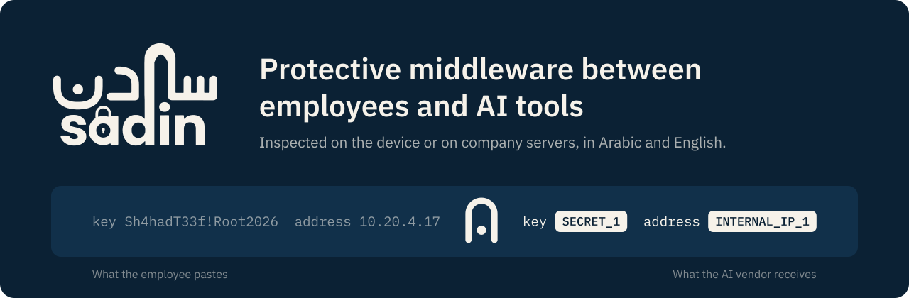
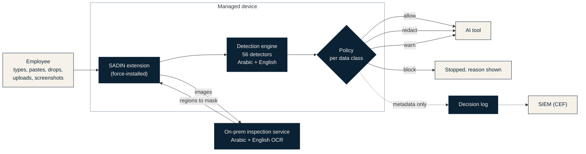
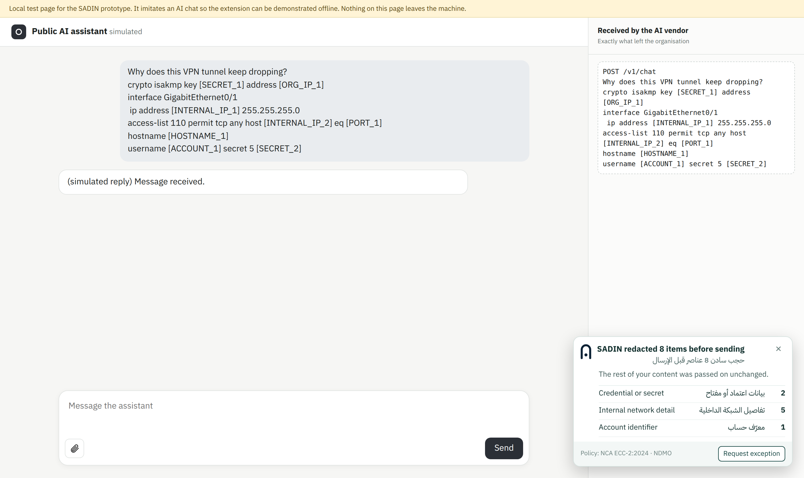
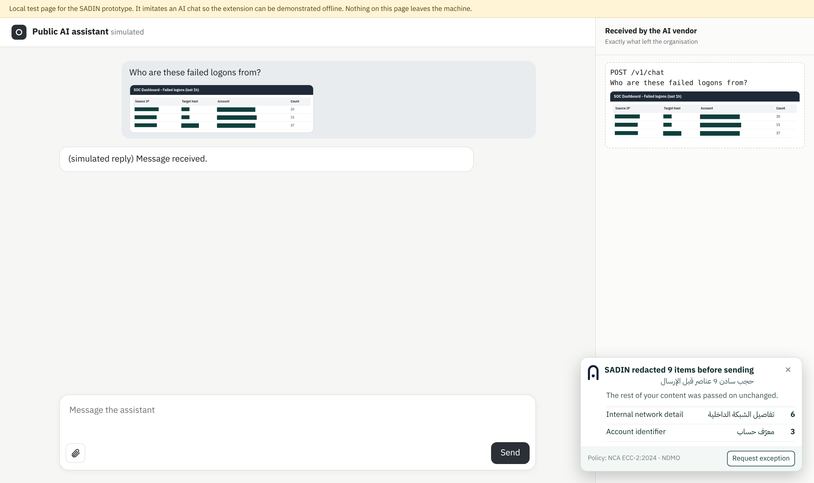
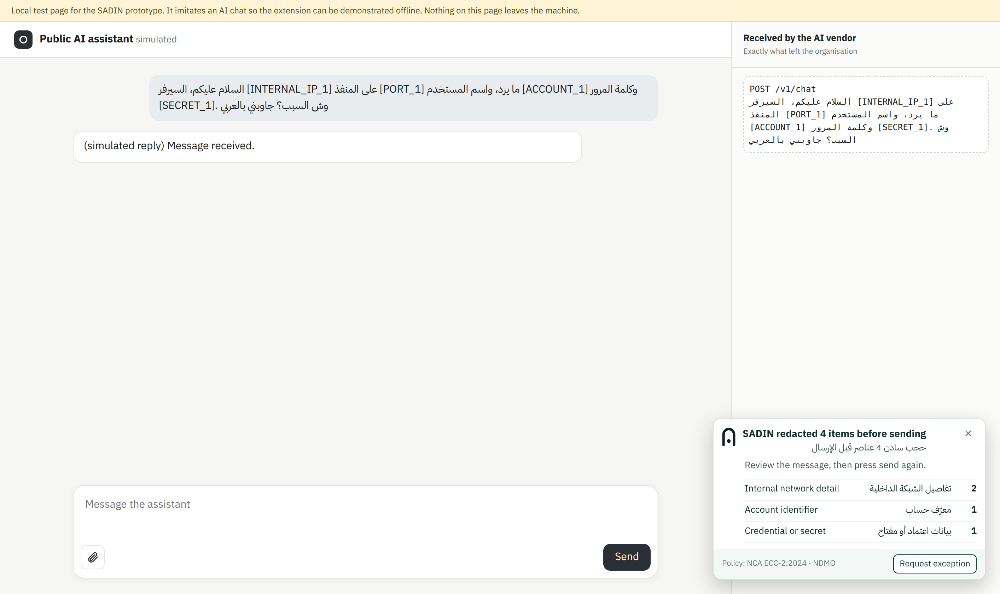
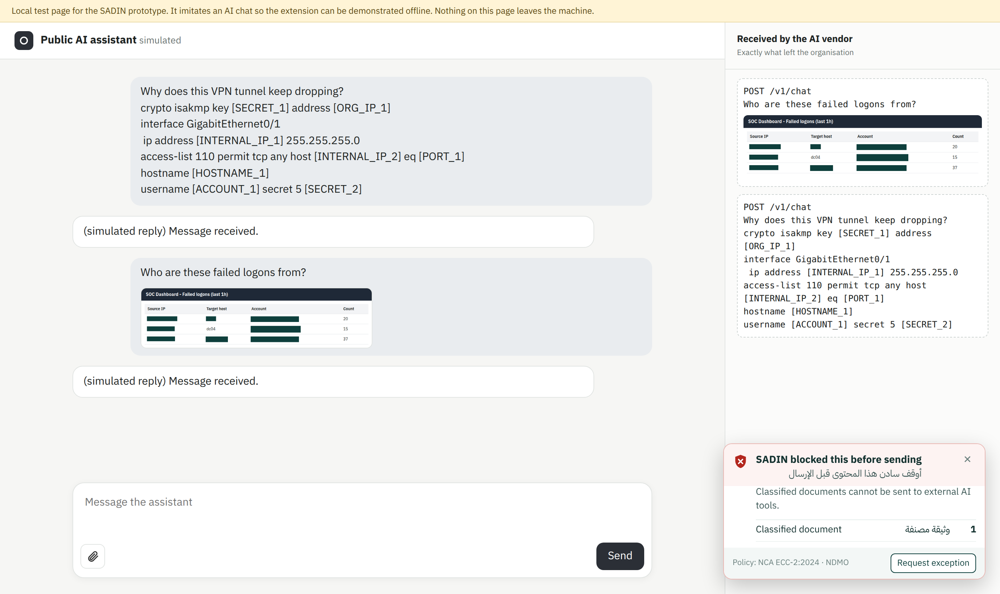
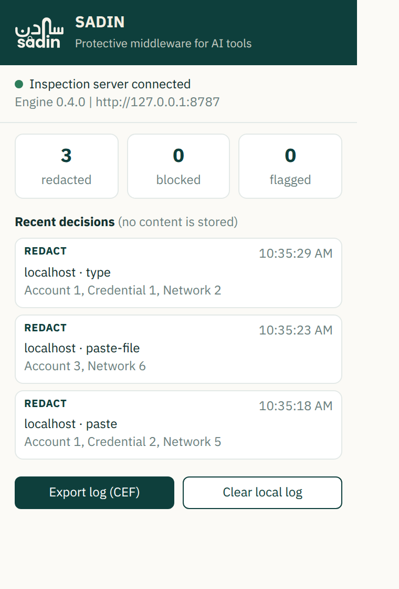

<p align="center">
  
</p>

<p align="center">
  
  
  
  
  
  
  
</p>

<p align="center">
  <a href="#the-problem">The problem</a> &nbsp;|&nbsp;
  <a href="#how-it-works">How it works</a> &nbsp;|&nbsp;
  <a href="#see-it-work">Demo</a> &nbsp;|&nbsp;
  <a href="#results">Results</a> &nbsp;|&nbsp;
  <a href="#quick-start">Quick start</a> &nbsp;|&nbsp;
  <a href="#documentation">Docs</a> &nbsp;|&nbsp;
  <a href="#references">References</a>
</p>

---

**SADIN** (سادن, the custodian who keeps a gate) is a protective middleware that sits between
employees and generative AI tools. Everything an employee types, pastes, drops or uploads into
an AI tool passes through SADIN first. Credentials, internal network details and account
identifiers are replaced with placeholders, classified documents are stopped, and every
decision is logged. The employee still gets an answer from the AI; the organisation's secrets
never reach the vendor.

All inspection runs on the employee's device or on the organisation's own server. A middleware
that shipped the data to another cloud would recreate the problem it exists to solve.

> **What changed since the SAIF submission (28 September 2026).** The submitted report and
> poster describe v0.4.0. Three things were added afterwards and are in this repository:
> PDF and Word inspection, sensitivity labels (both v0.6.0, 15 November), and tamper resistance
> with administrator alerts (v0.7.0, 17 November). A code audit on 17 November then found and
> fixed six bypasses and bugs (EVALUATION.md, section 5f); one of the fixes is in the detection
> engine, now v0.4.1, and no result on the existing test sets changed. Every test was run again
> on 17 November 2026; see [EVALUATION.md](EVALUATION.md), section 5e, and the
> [report addendum](docs/SADIN_Report_Addendum_v0.7.0.pdf).

## The problem

An engineer stuck on a VPN tunnel pastes the router configuration into an AI assistant. A SOC
analyst pastes a dashboard screenshot and asks who the failed logons came from. Nobody means
harm, but the pre-shared key, the internal addresses and the admin account names now sit in a
third party's chat history, and attackers do not need to break into the organisation to reach
them:

| Path | What happened |
|---|---|
| Stolen AI accounts | Group-IB found more than 225,000 infostealer logs containing ChatGPT credentials offered for sale between January and October 2023. Whoever buys a login can read the full chat history. |
| Chats shared by link | In July 2025, Fast Company found nearly 4,500 shared ChatGPT conversations in Google results; OpenAI then removed the option that made them discoverable. |
| Retention by the vendor | In March 2023, Samsung semiconductor engineers entered source code and meeting content into ChatGPT in three separate incidents within about 20 days; Samsung then banned generative AI tools on company devices from May 2023. |

Sources for each case are listed under [References](#references).

Blocking AI sites does not work either: usage moves to personal phones and the organisation
loses both visibility and the productivity gain. SADIN takes the third path: keep AI, remove
the secrets.

## How it works



One policy engine decides what happens to each class of data, and three enforcement points
apply it. The **Agent** (browser extension, plus an endpoint agent in Phase 2) covers managed
devices and is built. The **Identity** layer (SSO on an enterprise AI tenant with conditional
access) and the **Gateway** (reverse proxy for unmanaged devices) are designed and on the
roadmap. Details: [docs/ARCHITECTURE.md](docs/ARCHITECTURE.md).

### The employee cannot switch it off

The extension is installed by browser policy, so the browser itself refuses to disable or
remove it, and the same policy closes Incognito and guest mode. What policy cannot stop is
detected: the extension reports to the inspection service on a timer with how it was installed
and a fingerprint of its files, and the administrator is alerted when a device goes silent,
when the files were edited or deleted, or when the extension was not installed by policy.
Tested on Chrome under a real managed policy; Windows and Edge are not tested yet. Details:
[docs/TAMPER-RESISTANCE.md](docs/TAMPER-RESISTANCE.md).

### What it looks for

SADIN protects the organisation's own secrets, the things an attacker could use against it.

| Data class | Examples | Default action |
|---|---|---|
| Classified documents | "Secret", "سري للغاية", "التصنيف: مقيد", classification stamps on scanned memos | Block |
| Credentials and keys | Passwords (including "الباسوورد"), API keys, tokens, private keys, pre-shared keys, SNMP communities, `.env` values | Redact |
| Network details | Internal IPv4 and IPv6, hostnames, ports and port lists, MAC addresses, the organisation's public ranges, Arabic-Indic digits (١٠.١٥.٢.٢٠) | Redact |
| Account identifiers | Work email addresses, `DOMAIN\user` accounts, employee IDs, usernames (including "اليوزر") | Redact |
| Security findings | Scanner output, penetration-test markers, "ثغرة لم تُرقّع" style wording | Warn |

Actions are set per data class by IT through Chrome policy. PDF and Word (.docx) files are
read by the on-prem inspection service: a clean document goes through, a document that holds
protected content is held back whole (documents are not redacted in place yet). Anything SADIN
cannot inspect (password-protected, damaged or very long documents, documents with attachments
or macros, other Office formats and archives, and images or documents while the inspection
service is unreachable) is blocked rather than waved through.

A document the organisation has already classified does not need a recognisable pattern at
all: SADIN reads the sensitivity label in the file's metadata (Microsoft Purview labels and
plain classification properties, in Word and PDF) and applies the organisation's rule for the
NDMO level, by default holding back everything except Public. Detector list and Arabic handling:
[docs/DETECTION.md](docs/DETECTION.md).

## See it work

The demo runs on a local page that imitates an AI chat. The right-hand panel shows exactly what
the AI vendor would receive.

<table>
  <tr>
    <td width="50%"></td>
    <td width="50%"></td>
  </tr>
  <tr>
    <td>A router configuration is pasted. The pre-shared key, the password hash, the organisation's public address, both internal addresses, the port, the hostname and the account are replaced; the question still reaches the AI.</td>
    <td>A SOC dashboard screenshot is pasted. The on-prem service reads it with OCR and the sensitive cells are masked in the image itself. One short hostname (dc04) was missed, as reported in the evaluation.</td>
  </tr>
  <tr>
    <td></td>
    <td></td>
  </tr>
  <tr>
    <td>An Arabic request with an IP address in Arabic-Indic digits, a port, a username and a password. All four are replaced and the Arabic question arrives intact.</td>
    <td>A classified document is stopped before sending. Nothing reaches the vendor, and the employee sees why and can request an exception.</td>
  </tr>
</table>

<details>
<summary>The decision log (extension popup)</summary>
<br>
<p align="center"></p>
<p>Each decision records who, which tool, which channel, the action and the data classes found.
The content itself is never stored. The log exports to a SIEM in CEF format.</p>
</details>

## Results

Held-out test sets, written and frozen before the run, first run, no tuning afterwards.

| Metric | Result |
|---|---|
| Sensitive items caught in text | **86.3%** (44 of 51) |
| False positives on clean business prompts | **0 of 50** |
| Screenshot values masked (on-prem OCR) | **95.8%** (69 of 72) |
| Classified Arabic memos blocked in screenshots | **8 of 8** (4 with a stamp, 4 with a written classification line) |
| Arabic items caught (Arabic held-out set) | **36 of 36**, 1 false positive in 40 |
| Time per message / 1 MB paste / screenshot | under 0.1 ms / about 0.2 s / about 1.7 s |

PDF and Word inspection was added on 15 November 2026, after the SAIF submission, and is
measured separately:

| Metric | Result |
|---|---|
| Test documents with the expected outcome (secret in body, table, header, footnote, comment, link target, picture, scanned page...) | **60 of 60** (35 held back, 11 let through, 14 refused as uninspectable) |
| Labelled test documents with the expected outcome (harmless text, only the label differs) | **20 of 20** (15 held back, 5 let through); 2 more files record a known gap, where another tool dropped the label |
| Held-out items: same decision in a .docx as for the same text pasted | **150 of 150** |
| Held-out items: same decision in a PDF (first run) | **149 of 150** (LibreOffice), **148 of 150** (Chrome) |
| Clean documents held back by mistake | **0** |
| Time per document | a few ms (.docx), about 40 ms (PDF), 0.3 to 2 s when a page or picture needs OCR |

Tamper resistance and administrator alerts were added in v0.7.0 (17 November 2026):

| Metric | Result |
|---|---|
| Lab run on Chrome under a real managed policy: disable, remove, Incognito, guest mode, edited file, deleted file, deleted folder, deleted policy | **19 of 19** checks passed, run twice with the same outcome |
| Disable, remove, Incognito and guest mode with the policy in place | Refused by the browser |
| Edited or deleted extension file | Not noticed by the browser; administrator alerted in 25 to 30 s (30 s heartbeat) |
| Device that goes silent | Administrator alerted in 68 to 76 s (75 s grace period in the lab; 180 s by default) |
| Server-side checks: access rules, one alert per condition, forged lines, webhook delivery | **19 of 19** |

A code audit on the same day found six ways around SADIN or faults in it, all fixed and each
now covered by a test: a PDF or Word file renamed to `.txt` passed unread; UTF-16 text files
passed unread; invisible characters or Arabic tatweel inside a keyword hid it; a send button
with no label skipped the check on typed text; a page could read uploaded files before they
were inspected; and decisions logged while the service was down were never forwarded. Result:
**16 of 16** real-browser checks and **14 of 14** engine cases. Nine weaknesses that are not
fixed are recorded beside them as known gaps. See [EVALUATION.md](EVALUATION.md), section 5f.

The 17 November re-run of the screenshot benchmark, on a different machine, masked the same
69 of 72 values but blocked 7 of the 8 classified memos: one boxed stamp was not read. The
benchmark draws its images with the local browser and fonts, so the result moves with the
environment; the September figures above are the first run and stay the headline. See
[EVALUATION.md](EVALUATION.md), section 5e.

Before the Arabic work (engine v0.3.1), the same Arabic held-out set scored 50.0% (18 of 36).
The test sets are synthetic and were written by the team, so they show the approach works on
realistic phrasing, not how it performs on an organisation's real traffic; a consented pilot is
the next step. Method, raw outputs, bugs the tests found and limitations:
[EVALUATION.md](EVALUATION.md).

## Quick start

Requirements: Node.js 18+, Chrome (Edge should work but is untested), and for image inspection Tesseract 5 with the
`ara` and `eng` language data and ImageMagick (the service runs without it, but then classification stamps in images are not read). PDF and Word inspection also needs
`poppler-utils` and `qpdf`.

```bash
# 1. on-prem inspection service (text works without it; images, PDF and Word files need it)
TESSDATA_PREFIX=/path/to/tessdata node server/server.js   # http://127.0.0.1:8787

# 2. local test page that imitates an AI chat
node demo/serve.js                                        # http://localhost:8788

# 3. load the extension
#    chrome://extensions  >  Developer mode  >  Load unpacked  >  select extension/
```

Then paste a firewall configuration, type a password, upload a `.env` file, paste a
screenshot or attach one of the documents in `eval/file-fixtures/` on the test page. The extension is also configured for ChatGPT, Claude, Gemini,
Copilot, Perplexity, DeepSeek, Mistral and Poe.

### Reproduce the numbers

```bash
npm install                           # test-only packages (playwright, sharp); the product itself needs none
npm test                              # text sets, robustness cases, fingerprint check, server tests
node eval/run.js --holdout            # English held-out set
node eval/run.js --set=arabic-holdout # Arabic held-out set
node eval/run.js                      # English development set
node eval/run.js --set=arabic-dev     # Arabic development set
sha256sum -c eval/FROZEN-arabic.sha256
TESSDATA_PREFIX=... SADIN_SEED=990011 node eval/ocr-eval.js   # screenshots
node eval/e2e-browser.js              # real browser, needs demo/serve.js running
TESSDATA_PREFIX=... node eval/files-eval.js                   # PDF and Word test documents
node eval/e2e-files.js                # real browser, PDF and Word uploads (needs both servers)
node eval/e2e-audit.js                # real browser: the bypasses fixed in the 17 November audit (starts its own servers)
node eval/robustness.js               # engine: invisible characters, tatweel, and the recorded known gaps
node eval/tamper/server-test.js       # heartbeats, alerts, access rules, webhook
sudo python3 eval/tamper/tamper_test.py   # tamper lab: real Chrome under managed policy, Linux, about 10 minutes
```

### Deploy in an organisation

Force-install the extension with the `ExtensionInstallForcelist` policy, push `serverUrl`,
`serverToken`, `orgDomains`, `orgPublicCidrs` and the per-class actions through managed
storage, and run the inspection service on an internal VM with `SADIN_TOKEN` and
`SADIN_EXTENSION_IDS` set. The lock-down policy templates are in
[`deploy/policies/`](deploy/policies/), and tamper alerts appear on the service's `/admin`
page. Roll out in monitor-only mode, then warn, then enforce. Step by step:
[docs/DEPLOYMENT.md](docs/DEPLOYMENT.md).

## Project status

| Component | Status |
|---|---|
| Browser extension (Manifest V3) | Built and tested on Chrome. Edge uses the same extension format but has not been tested |
| Detection and redaction engine, Arabic and English | Built and tested |
| On-prem inspection service: OCR, stamp reading, policy, log, CEF export | Built and tested |
| PDF and Word (.docx) inspection: pass or hold back the whole file | Built and tested (v0.6.0) |
| Sensitivity labels in PDF and Word metadata, mapped to NDMO levels | Built and tested on files written to the published format (v0.6.0); not yet tried on a file labelled by a real Purview tenant |
| Tamper resistance: force-install and lock-down policy, heartbeat, file fingerprint, administrator alerts and `/admin` page | Built and tested on Chrome on Linux (v0.7.0); Windows and Edge policy files are untested templates |
| Evaluation harness, held-out sets, real-browser tests, tamper lab | Built |
| Coverage of AI sites | Eight sites listed in the manifest (ChatGPT, Claude, Gemini, Copilot, Perplexity, DeepSeek, Mistral, Poe). All browser tests used the local test page; the live sites have not been tested, and any other AI site is not covered until it is added |
| Redaction inside documents, Excel and PowerPoint, endpoint agent, document fingerprinting | Phase 2 (pilot) |
| Enterprise AI tenant, SSO and conditional access, personal-account blocking | Phase 3 |
| Gateway mode for unmanaged devices | Phase 4 |

## Documentation

| Document | What it covers |
|---|---|
| [Concept and technical report](docs/SADIN_Report_SAIF2026.pdf) | The full report as submitted to SAIF in September 2026 (v0.4.0): problem, threat model, design, detection, security, compliance, results, roadmap |
| [Report addendum](docs/SADIN_Report_Addendum_v0.7.0.pdf) | What changed after the submission: PDF and Word inspection, sensitivity labels, tamper resistance, the 17 November re-run, corrections to the report |
| [Architecture](docs/ARCHITECTURE.md) | Enforcement points, components, request lifecycle, what is built and what is designed |
| [Detection](docs/DETECTION.md) | Data classes, all 56 detectors, Arabic handling, OCR pipeline, redaction |
| [Threat model](docs/THREAT-MODEL.md) | How data leaves, what SADIN covers, what it cannot, threats to SADIN itself |
| [Tamper resistance](docs/TAMPER-RESISTANCE.md) | Lock-down policy, heartbeat, file fingerprint, administrator alerts, the lab run and its limits |
| [Deployment](docs/DEPLOYMENT.md) | Force-install, managed settings, server hardening, rollout |
| [Compliance](docs/COMPLIANCE.md) | NCA ECC-2:2024 and NDMO classification mapping, human oversight |
| [Evaluation](EVALUATION.md) | Test method, results, raw outputs, limitations |
| [Security policy](SECURITY.md) | Reporting issues, security properties of the prototype |
| [Changelog](CHANGELOG.md) | What changed between versions |
| [Poster](docs/SADIN_Poster_SAIF2026.pdf) | SAIF 2026 scientific poster |

## Repository layout

```
extension/   Browser extension. src/engine.js is the detection engine shared by all parts.
server/      On-prem inspection service and administrator page. No npm dependencies.
deploy/      Browser policy templates that force-install and lock down the extension.
demo/        Local test page that imitates an AI chat.
eval/        Test sets, harness and raw results.
shots/       Screenshots of the prototype in use.
docs/        Report, architecture, detection, threat model, deployment, compliance, poster.
assets/      Logo, app icon, banner.
```

## References

1. National Cybersecurity Authority (NCA). *Essential Cybersecurity Controls, ECC-2:2024*. Riyadh, 2024.
2. National Data Management Office (NDMO), SDAIA. *National Data Governance Policies: Data Classification Policy*. [sdaia.gov.sa](https://sdaia.gov.sa/ar/SDAIA/about/Documents/Data%20Classification%20Policy.pdf)
3. Group-IB. "Group-IB Discovers 100K+ Compromised ChatGPT Accounts on Dark Web Marketplaces." Press release, 20 June 2023. [group-ib.com](https://www.group-ib.com/media-center/press-releases/stealers-chatgpt-credentials/)
4. Group-IB. *Hi-Tech Crime Trends 2023/2024*. February 2024. [prnewswire.com](https://www.prnewswire.com/news-releases/group-ib-reveals-hi-tech-crime-trends-2324-surge-in-ransomware-against-backdrop-of-growing-ai-macos-threats-302075538.html)
5. The Economist Korea, 30 March 2023; Bloomberg, "Samsung Bans Staff's AI Use After Spotting ChatGPT Data Leak," 2 May 2023.
6. Fast Company, July 2025, investigation of shared ChatGPT conversations indexed by Google; OpenAI's removal of the discoverability option, as reported by PC Gamer, August 2025. [pcgamer.com](https://www.pcgamer.com/software/ai/chatgpt-removes-the-ability-for-conversations-to-be-displayed-by-search-engines-as-nearly-4-500-conversations-indexed-by-google/)
7. Google, Chrome for Developers. "Replace blocking web request listeners" (Manifest V3; `webRequestBlocking` remains available to policy-installed extensions). [developer.chrome.com](https://developer.chrome.com/docs/extensions/develop/migrate/blocking-web-requests)
8. OWASP. *Top 10 for Large Language Model Applications 2025*: LLM02 Sensitive Information Disclosure.
9. Tesseract OCR, open-source OCR engine. [github.com/tesseract-ocr/tesseract](https://github.com/tesseract-ocr/tesseract)
10. Saudi Press Agency. "Registration Opens for Global Security and Innovation Fair and Competition," 22 July 2026. [spa.gov.sa](https://www.spa.gov.sa/en/N2639485)
11. SAIF 2026 participant guide (official competition guide supplied to participants).
12. Google, Chrome Enterprise and Education Help. "Set Chrome app and extension policies" (force-installed extensions cannot be disabled or removed by users). [Linux](https://support.google.com/chrome/a/answer/7517525), [Windows](https://support.google.com/chrome/a/answer/7532015)

## About

SADIN is an entry to SAIF 2026, the Security & Innovation Fair, in Track 02: Cybersecurity and
Defensive Technologies.

All values in the test sets are fabricated, including the API keys and tokens in `eval/`, which
only look real so the detectors can be tested against them. None of them is a live credential.
