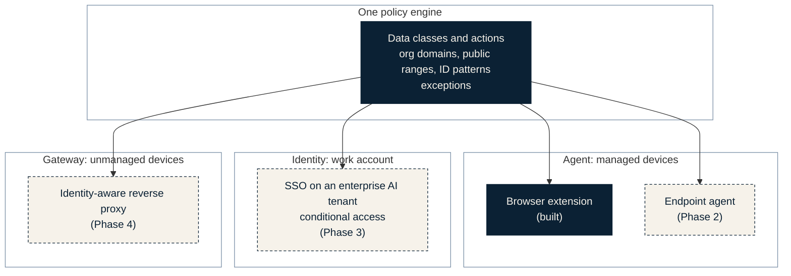
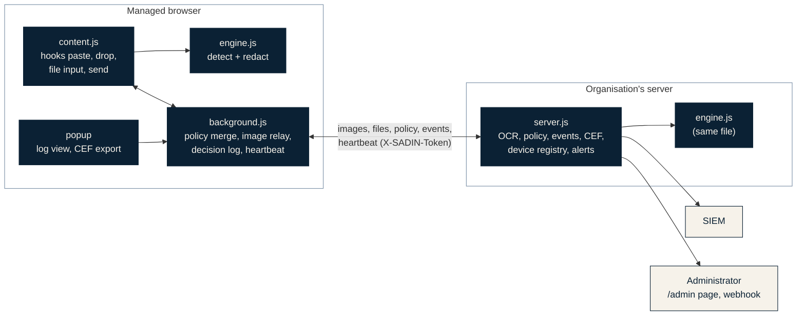
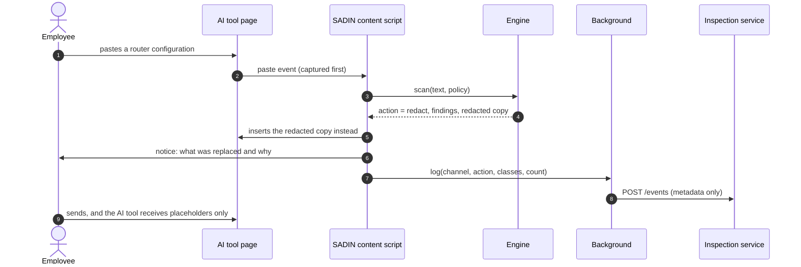

# Architecture

SADIN is a middleware: it stands between the employee and every AI tool, and everything the
employee sends passes through it. It is built from **one policy engine** and **three
enforcement points**, and it follows four rules throughout.

1. **Inspect locally.** Content is inspected on the device or on the organisation's own
   server. Nothing is sent to a SADIN cloud, because there is none.
2. **Redact before blocking.** Remove the sensitive part and let the rest through, so the
   employee still gets help.
3. **Fail closed.** Content SADIN cannot inspect is blocked, not waved through.
4. **Log decisions, not content.** The log records who, which tool, which channel, which action
   and which data classes. Never the text or the image.

## Enforcement points



| Enforcement point | Covers | State |
|---|---|---|
| **Agent: browser extension** | Typed, pasted and dragged text, file uploads (text formats, PDF, Word) and pasted or uploaded images on the configured AI chat sites in a managed browser. Force-installed and locked by policy, with a heartbeat that tells the administrator when protection stops ([TAMPER-RESISTANCE.md](TAMPER-RESISTANCE.md)) | Built and tested on Chrome; Edge untested |
| **Agent: endpoint agent** | Desktop AI apps, IDE assistants, the clipboard, redaction inside documents, Excel and PowerPoint, device posture | Designed, Phase 2 |
| **Identity** | AI access only through the work account on an enterprise AI tenant; company data only on compliant devices; personal AI accounts blocked on work devices | Designed, Phase 3 |
| **Gateway** | Sessions from unmanaged devices routed through a reverse proxy that applies the same policy | Designed, Phase 4 |

The Identity layer closes most of the personal-device gap at its source: if company email,
files and systems are only reachable from managed devices, an employee on a home laptop has no
company data to paste.

## Components in this repository



| Component | File | Role |
|---|---|---|
| Content script | `extension/src/content.js` | Runs inside AI tool pages. Intercepts paste, drop, file-input changes and send (Enter or the send button), asks the engine, then lets the sanitised content through, blocks it, or shows a notice. A file is routed by its first bytes, not its name, so a renamed PDF still goes to the inspection service. |
| Detection engine | `extension/src/engine.js` | 56 detectors across five data classes, Arabic and English. Returns findings (class, detector, character span) and a redacted copy. Pure JavaScript, no dependencies; the extension, the server and the tests run the same file. |
| Background worker | `extension/src/background.js` | Merges the policy (built-in defaults, then the policy server, then Chrome managed storage set by IT, which wins). Relays images to the inspection service. Keeps the last 500 decisions locally and forwards each one to the server. Sends the heartbeat: device name, install type and a fingerprint of the extension's files. |
| Popup | `extension/popup/` | Shows server status and recent decisions; exports the local log as CEF. |
| Managed settings | `extension/managed_schema.json` | The settings IT pushes by policy: `serverUrl`, `serverToken`, `userEmail`, `deviceId`, `heartbeatSeconds`, org domains and ranges, per-class actions, fail-closed behaviour. |
| Inspection service | `server/server.js` | Arabic and English OCR with Tesseract, a second pass for coloured classification stamps, image masking coordinates, `/policy`, `/events`, `/events.cef`. Node only, no npm dependencies. |
| Document inspection | `server/files.js`, `server/labels.js` | Text extraction from PDF and Word files and reading of sensitivity labels (v0.6.0). |
| Tamper resistance | `server/server.js`, `server/integrity.js`, `server/admin.html` | Device registry, heartbeat watchdog, the five administrator alerts, `/devices`, `/alerts`, `/alerts.cef`, the `/admin` page, optional webhook; `integrity.js` records the expected fingerprint of a release (v0.7.0). |
| Policy templates | `deploy/policies/` | Browser policy files that force-install the extension and switch off Incognito, guest mode, new profiles and developer tools. |
| Test page | `demo/` | A local page that imitates an AI chat and shows exactly what the vendor would receive. |

## Request lifecycle

### Text: paste, drop or send



Typed text is checked at send time. If it needs redaction, SADIN replaces the text in the
message box, stops that send, and asks the employee to review and send again, so nothing leaves
without the employee seeing what changed.

### Images: paste or upload

1. The content script holds the image and asks the background worker to send it to the
   inspection service.
2. The service upscales small screenshots, runs Tesseract with Arabic and English, and runs a
   second pass over coloured ink to read boxed classification stamps that ordinary page
   segmentation skips.
3. The recognised words go through the same engine. The service returns the action, the data
   classes and the rectangles to mask. It never echoes the recognised text back.
4. If the action is block, the image is stopped. Otherwise the content script paints over the
   rectangles on a canvas and passes the masked copy to the page.
5. If the service is unreachable, images are blocked (fail closed) and the popup says so.

### Files

Text formats (about forty extensions, including `.env`, `.conf`, `.json`, `.yaml`, `.log`,
`.sql`, `.pem` and source code) are read and redacted in the browser, and a sanitised copy replaces the original in the
upload.

PDF and Word (.docx) files go to the inspection service (`POST /inspect/file`, code in
`server/files.js`), which recognises the format from the content, not the file name:

1. PDF: `pdftotext` gives the text layer; `qpdf` gives form-field values, comments, link
   targets and document properties; pages with pictures, and PDFs with no text layer, are
   rendered and read with OCR.
2. Word: the document is unzipped in memory and the body, tables, text boxes, headers, footers,
   notes, comments, tracked deletions, link targets, properties and chart labels are read;
   embedded pictures go through OCR. Parts are allow-listed, so an unknown part stops the file.
3. The sensitivity label, if the file carries one, is read from its metadata
   (`server/labels.js`): Purview `MSIP_Label_<GUID>_...` properties, the Word label list, and
   plain classification properties. The label's name or GUID is mapped to an NDMO level and
   the level's action applies (block for everything but Public by default; a label with no
   rule is blocked).
4. The text goes through the same engine; content can only make the outcome stricter than the
   label did. The service answers with the decision, the data classes, the label level and
   counters, never the text. Temporary files are deleted.
5. A document is not redacted in place yet: if the engine would redact or block, the whole
   file is held back and the employee is told why. A clean file is passed on unchanged.
6. A file that cannot be fully read (encrypted, damaged, over 60 pages, more than 8 scanned
   pages or pictures, attachments, embedded objects, macros) is reported as uninspectable.
   If the service is unreachable, the file is blocked (fail closed).

Uninspectable files and formats the prototype cannot parse (Excel, PowerPoint, legacy Office,
archives) follow the `uninspectableFiles` policy, which is `block` by default.

## Policy

```json
{
  "orgDomains": ["corp.example.sa", "example.sa"],
  "orgPublicCidrs": ["203.0.113.0/24"],
  "employeeIdPattern": "\\bEMP-?\\d{5,6}\\b",
  "failClosed": true,
  "uninspectableFiles": "block",
  "actions": {
    "CLASSIFIED": "block",
    "CREDENTIAL": "redact",
    "NETWORK": "redact",
    "ACCOUNT": "redact",
    "SECURITY_FINDING": "warn"
  }
}
```

Each data class maps to one of four actions: `allow`, `redact`, `warn` or `block`. When a
message contains several classes, the strictest action wins. The employee can request an
exception from the notice; the business justification is logged for the security team, and the
content is still not sent.

## What the log contains

```json
{"time":"2026-09-25T17:21:28.205Z","user":"a.alharbi@corp.example.sa","tool":"chatgpt.com",
 "channel":"paste","action":"redact","categories":{"CREDENTIAL":2,"NETWORK":5,"ACCOUNT":1},
 "placeholders":8}
```

That is the whole record. No text, no image, no matched value. The server writes it to
`events.jsonl` and serves it as CEF at `/events.cef` for SIEM ingestion.
