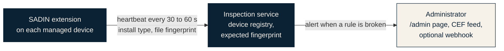
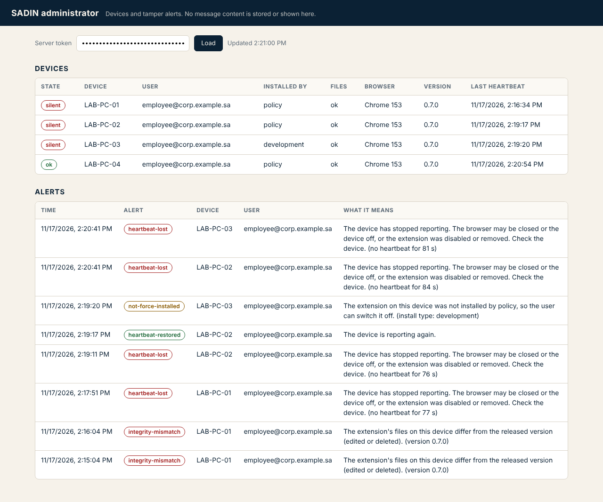

# Tamper resistance and administrator alerts

Two requirements were added in November 2026: the employee must not be able to switch SADIN
off, and the responsible administrator must be told when protection stops on a device. This
page describes how both are met, what was tested, and what was not.

**Result of the lab run: 19 of 19 checks passed**, on Google Chrome for Testing 153.0.8010.12 under a real managed
policy, on Linux. The run was done twice on 17 November 2026 with the same outcome for every
check. Windows and Edge were not tested.

## History of this feature

- **0.5.0, 11 November 2026.** First built and lab-tested (18 of 19 checks at the time; guest
  mode could not be exercised). That package was never published to this repository and was
  not kept.
- **0.7.0, 17 November 2026.** Rebuilt to the same design on top of the 0.6.0 code, and
  extended: the manifest is now part of the file fingerprint, guest mode is exercised, the
  webhook is tested, and the server has its own test. Every number on this page comes from the
  17 November runs.

## Two layers

**Prevention, by browser policy.** The extension is installed by the `ExtensionInstallForcelist`
policy. The browser then refuses to disable or remove it. The same policy file switches off
Incognito windows and guest mode, where the extension would be absent. Templates are in
[`deploy/policies/`](../deploy/policies/).

**Detection, by heartbeat.** Policy cannot cover everything: the files of an extension hosted
outside the Chrome Web Store are not verified by the browser, and someone with administrator
rights can delete the policy. So the extension reports to the inspection service on a timer,
and the service raises an alert when a rule is broken.



| Signal | Sent by | Alert |
|---|---|---|
| Heartbeat on a timer (managed `heartbeatSeconds`, minimum 30, default 60) | Extension | `heartbeat-lost` after `SADIN_HEARTBEAT_GRACE_S` (default 180 s), then `heartbeat-restored` |
| How the extension was installed (`admin` means by policy) | Extension | `not-force-installed` |
| SHA-256 fingerprint of `manifest.json`, `engine.js`, `content.js` and `background.js` as they are on disk | Extension, compared with `server/integrity.json` | `integrity-mismatch` |
| Uninstall address opened by the browser | Browser | `extension-uninstalled` |

Alerts are appended to `server/alerts.jsonl`, listed at `GET /alerts`, exported as CEF at
`GET /alerts.cef`, shown on the `/admin` page, and posted as JSON to `SADIN_ALERT_WEBHOOK` when
that is set (for a mail relay, Teams or a SOAR). An alert carries the device name, the user,
the alert type and the time. It never carries message content.



## Lab run

`eval/tamper/tamper_test.py`. Nothing is simulated: the extension is packed as a signed CRX,
served from a local update server, force-installed by a managed-policy file, and the real
inspection service receives the heartbeats. Each attempt is made the way the browser's own
extensions page would make it.

| | |
|---|---|
| Browser | Google Chrome for Testing 153.0.8010.12 |
| System | Linux 6.18.44-fc-v553 |
| Extension | 0.7.0, heartbeat every 30 s |
| Server grace period | 75 s (shortened for the lab; the default is 180 s) |

**Managed device: SADIN is force-installed by policy**

| # | What was tried | Expected | Observed | Result |
|---|---|---|---|---|
| A1 | Extension arrives with no user action<br>*Policy ExtensionInstallForcelist, private update server* | Installed and enabled by policy | installed in 2 s, state ENABLED, location UNKNOWN | Pass |
| A2 | Device reports to the server<br>*First heartbeat* | Registered, installed by policy, files match the release | after 1 s: state ok, install type admin, files ok | Pass |
| A3 | The extensions page offers no way to change it<br>*Read the controls the page is given for this extension* | User may not modify it | userMayModify=False, mustRemainInstalled=True | Pass |
| A4 | Employee disables the extension<br>*chrome.management.setEnabled(false) from the extensions page* | Browser refuses | refused: Extension (id) cannot be modified by user.; still ENABLED | Pass |
| A5 | Employee removes the extension<br>*chrome.management.uninstall from the extensions page* | Browser refuses | refused: Extension (id) cannot be modified by user.; still installed | Pass |
| A6 | Employee opens an Incognito window<br>*chrome.windows.create({incognito:true}) under IncognitoModeAvailability=1* | Browser refuses | refused: Incognito mode is disabled. | Pass |
| A7 | Employee edits a script of the installed extension<br>*Append a line to src/content.js in the profile folder* | Administrator alerted (integrity-mismatch) | alert after 25 s; the browser itself still shows the extension as ENABLED | Pass |
| A8 | Original file put back<br>*Restore src/content.js* | Device returns to ok | state ok after 29 s | Pass |
| A9 | Employee deletes the detection engine file<br>*Delete src/engine.js in the profile folder* | Administrator alerted (integrity-mismatch) | alert after 30 s | Pass |
| A10 | Employee deletes the extension's folder<br>*Remove the folder from the profile with the browser closed, reopen* | Administrator alerted, or the browser repairs it | browser did not restore the folder; alert heartbeat-lost after 68 s | Pass |

**Guest mode**

| # | What was tried | Expected | Observed | Result |
|---|---|---|---|---|
| G1 | Employee starts the browser in guest mode<br>*Start Chrome with --guest under BrowserGuestModeEnabled=false* | No guest session; SADIN is present | browser opened the 'Default' profile; SADIN installed | Pass |
| G2 | Same start without the guest-mode policy<br>*Start Chrome with --guest, policy without BrowserGuestModeEnabled* | Guest session without SADIN (the gap the policy closes) | browser opened the 'Guest Profile' profile; SADIN absent | Pass |

**The policy itself is removed (needs administrator rights on the device)**

| # | What was tried | Expected | Observed | Result |
|---|---|---|---|---|
| B1 | Someone with administrator rights deletes the policy file<br>*Remove the managed-policy file while the browser runs* | Prevention is lost; administrator alerted | extension removed by the browser after 5 s; alert heartbeat-lost after 71 s | Pass |
| B2 | Policy file restored<br>*Write the managed-policy file again while the browser runs* | Extension returns by itself; administrator told | extension back after 5 s; heartbeat-restored after 0 s | Pass |

**No policy: what the policy is for**

| # | What was tried | Expected | Observed | Result |
|---|---|---|---|---|
| C1 | Extension installed by hand, not by policy<br>*Load the same extension without ExtensionInstallForcelist* | Administrator alerted (not-force-installed) | alert after 4 s; install type development | Pass |
| C2 | Employee disables it when no policy protects it<br>*chrome.management.setEnabled(false) from the extensions page* | Browser allows it (this is why force-install is required) | userMayModify=True; accepted; now DISABLED | Pass |
| C3 | Employee opens an Incognito window when no policy forbids it<br>*chrome.windows.create({incognito:true}), no IncognitoModeAvailability* | Browser allows it (control for A6) | accepted (no window object returned, as Chrome does for an extension without Incognito access) | Pass |
| C4 | Disabled extension goes silent<br>*Wait for the server's grace period* | Administrator alerted (heartbeat-lost) | alert after 76 s | Pass |

**Administrator view**

| # | What was tried | Expected | Observed | Result |
|---|---|---|---|---|
| D1 | Administrator opens the admin page<br>*GET /admin, enter the token* | Devices and alerts are listed | 4 devices and 8 of 8 alerts shown | Pass |

Raw output: [`eval/results-tamper-lab.json`](../eval/results-tamper-lab.json) (second run) and
[`eval/results-tamper-lab-RUN1.json`](../eval/results-tamper-lab-RUN1.json) (first run).

### What the run showed

- **The browser enforces the policy.** Disabling, removing, Incognito and guest mode were all
  refused (A4, A5, A6, G1). The controls C2, C3 and G2 show the same actions succeed when the
  policy is missing, so the refusals come from the policy and not from the test method.
- **The browser does not protect the extension's files.** An edited script and a deleted
  engine file were not noticed by the browser, which still showed the extension as enabled
  (A7, A9). The file fingerprint caught both, within one heartbeat. A heartbeat alone would
  have kept arriving and shown nothing wrong.
- **A deleted extension folder is not repaired by the browser** (A10). The extension went
  silent and the server flagged it after the grace period.
- **Administrator rights defeat prevention, not detection.** With the policy file deleted the
  browser removed the extension within seconds (B1). The server flagged the silence, and
  restoring the policy brought the extension back by itself (B2).
- **The uninstall address did not fire** when the browser removed the extension in B1. Do not
  rely on `extension-uninstalled`; the heartbeat covered it.
- **Time to an alert** is one heartbeat for a file change (25 to 30 s here) and the grace
  period for silence (68 to 76 s here with a 75 s grace period; up to about 3 minutes with the
  defaults).

## Server test

`eval/tamper/server-test.js` plays the part of the extension with plain HTTP calls and checks
the server on its own: **19 of 19 checks passed**. It covers what the lab run does not:

- heartbeats and alerts are refused without the token, and a web page cannot read the device
  registry;
- each condition is alerted once, not on every heartbeat;
- a version with no recorded fingerprint is marked `unchecked` rather than alerted;
- the uninstall address is ignored without the right key;
- line breaks in a device or user name cannot forge an alert line;
- every alert reached a local webhook receiver (10 of 10).

Raw output: [`eval/results-tamper-server.json`](../eval/results-tamper-server.json).

## Limits

- **Linux lab, not Windows.** The Windows and Edge policy files in `deploy/policies/` are
  templates that have not been run. Edge has not been tested at all.
- **Developer tools and new browser profiles** are switched off in the templates
  (`DeveloperToolsAvailability`, `BrowserAddPersonEnabled`) but were not part of the lab run.
- **A lost heartbeat is not proof of tampering.** The device may be off or the browser closed.
  The alert says "check the device". Telling the two apart needs the endpoint agent, which is
  not built.
- **The fingerprint is computed by the extension itself.** Someone who also rewrites
  `background.js` so that it reports the old fingerprint is not caught. It raises the effort;
  it is not a guarantee. Publishing the extension privately on the Chrome Web Store adds the
  browser's own signed file verification; that route was not tested here.
- **Other files are not fingerprinted.** The popup and the icons are outside the fingerprint;
  the four files that decide what is inspected are inside it.
- **The token is shared.** A user who extracts it from the managed settings could send fake
  heartbeats from another program.
- **No email is sent by SADIN itself.** Delivery beyond the admin page goes through the
  webhook. The webhook was tested against a local receiver, not against a real mail relay or
  Teams.
- **Another browser** that is not managed is outside all of this. Application control
  (AppLocker or WDAC) is the answer, and it is deployment guidance, not something SADIN does.
- **Firefox and Safari** are not covered.

## Reproduce

Server test, about one minute, Node 18+ only:

```bash
node eval/tamper/server-test.js
```

Lab run, about ten minutes. Linux, root (it writes the browser's managed-policy folder and
removes its file at the end), Chrome or Chrome for Testing, Node 18+, openssl, Python 3 with
Playwright; ports 8787 and 8790 free:

```bash
sudo python3 eval/tamper/tamper_test.py
```

## Repeat on Windows before claiming it

1. Join a test device to a domain or Intune and sign in as a standard user.
2. Pack the extension, host it with an update manifest, and run `node server/integrity.js`.
3. Import `deploy/policies/chrome-windows.reg` (or push the same values by Group Policy), with
   the placeholders filled in. For Edge use `edge-windows.reg`.
4. Try each row of the tables above by hand and record what happens.
5. Confirm the alerts on `/admin`.
